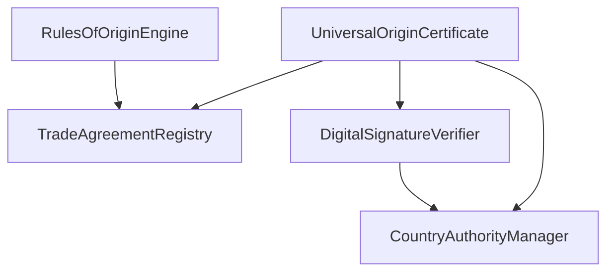

# Universal Origin Certification System

A blockchain-based system for creating, issuing, and verifying certificates of origin that works with any country and trade agreement. Built on Ethereum/EVM-compatible chains using Solidity.

## 🌍 Overview

This system provides a universal framework for digital certificates of origin that supports:

- **Multiple Trade Agreements**: USMCA/T-MEC, CAFTA-DR, CPTPP, EU agreements, and more
- **Any Country**: Flexible architecture supporting any country's requirements
- **Digital Signatures**: Support for FIEL (Mexico), eIDAS (EU), and other e-signature standards
- **Rules of Origin**: Comprehensive engine for calculating RVC, checking CTC, and other criteria
- **Multi-Party Workflow**: Exporter → Issuer → Customs validation flow

## 📋 Features

### Core Capabilities

1. **Universal Certificate Creation**
   - Support for any HS code classification
   - Flexible product information structure
   - Multi-currency support
   - Batch product processing

2. **Trade Agreement Flexibility**
   - Pre-configured major agreements (USMCA, CAFTA-DR, CPTPP)
   - Easy addition of new agreements
   - Country-specific rules and exceptions
   - Cumulation and de minimis provisions

3. **Digital Signature Support**
   - FIEL integration for Mexico
   - eIDAS support for EU
   - Generic PKI for other countries
   - Multi-signature workflows

4. **Rules of Origin Engine**
   - Regional Value Content (RVC) calculations
   - Change in Tariff Classification (CTC) verification
   - Wholly Obtained (WO) criteria
   - Product-Specific Rules (PSR)
   - Combination criteria

5. **Authority Management**
   - Country-specific issuer registration
   - Chamber of Commerce support
   - Government agency integration
   - Trusted trader programs

## 🏗️ Architecture

### Smart Contracts

```
origin-certification/
├── core/
│   ├── UniversalOriginCertificate.sol    # Main certificate contract
│   ├── DigitalSignatureVerifier.sol      # Multi-country signature support
│   └── RulesOfOriginEngine.sol           # Origin determination logic
├── registry/
│   ├── TradeAgreementRegistry.sol        # Trade agreement rules
│   └── CountryAuthorityManager.sol       # Authority permissions
└── interfaces/
    ├── IOriginCertificate.sol
    └── ITradeAgreement.sol
```

### Contract Interactions



## 🚀 Getting Started

### Prerequisites

- Node.js >= 14.0.0
- Hardhat
- An Ethereum wallet with test ETH

### Installation

```bash
# Clone the repository
git clone [repository-url]

# Install dependencies
cd verifiable_credential_WEB3
npm install

# Compile contracts
npx hardhat compile
```

### Testing

```bash
# Run all tests
npx hardhat test test/origin-certification/UniversalOriginCertificate.test.js

# Run with coverage
npx hardhat coverage --testfiles "test/origin-certification/*.test.js"
```

### Deployment

```bash
# Deploy to local network
npx hardhat run scripts/deployment/origin-certification/deploy-origin-system.js --network localhost

# Deploy to testnet (e.g., Goerli)
npx hardhat run scripts/deployment/origin-certification/deploy-origin-system.js --network goerli

# Deploy to mainnet
npx hardhat run scripts/deployment/origin-certification/deploy-origin-system.js --network mainnet
```

## 📝 Usage Examples

### 1. Creating a Certificate (Exporter)

```javascript
const exporterDetails = {
    name: "Mexican Electronics SA de CV",
    address: "Av. Industrial 123, CDMX, Mexico",
    taxId: "MEL950515HD7",
    phone: "+52-555-1234567"
};

const products = [{
    hsCode: "854140",
    description: "Photosensitive semiconductor devices",
    quantity: 1000,
    unitOfMeasure: "UNIT",
    countryOfOrigin: "MX",
    value: ethers.utils.parseEther("50000"),
    currency: "USD",
    manufacturer: "Mexican Electronics SA de CV",
    manufacturerCountry: "MX",
    additionalData: "0x"
}];

const criteria = {
    agreementCode: "USMCA",
    criteriaType: "RVC",
    rvcPercentage: 75,
    rvcMethod: "NET_COST",
    cumulationApplied: false,
    deminimisApplied: false,
    specificRule: "RVC 75% for electronics",
    proofDocuments: "0x"
};

const certificateId = await originCertificate.createCertificate(
    JSON.stringify(exporterDetails),
    JSON.stringify(importerDetails),
    JSON.stringify(producerDetails),
    "MX",  // Export country
    "US",  // Import country
    "USMCA",
    products,
    criteria,
    invoiceHash,
    "MX-US-2024-001"
);
```

### 2. Issuing a Certificate (Authorized Issuer)

```javascript
// Mexican Chamber of Commerce issues the certificate
const validityPeriod = 4 * 365 * 24 * 60 * 60; // 4 years for USMCA
const ipfsHash = "ipfs://QmSupportingDocuments...";
const signature = await signer.signMessage(certificateId);

await originCertificate.issueCertificate(
    certificateId,
    validityPeriod,
    ipfsHash,
    signature
);
```

### 3. Adding Digital Signatures

```javascript
// Register signer with FIEL
await signatureVerifier.registerSigner(
    signerAddress,
    "SABM960611SP4", // RFC
    "FIEL",
    "MX",
    validUntil,
    publicKeyHash
);

// Sign document
const metadata = {
    signerRole: "EXPORTER",
    signerName: "Company Name",
    signerTaxId: "SABM960611SP4",
    signatureStandard: "FIEL",
    additionalData: "0x"
};

await signatureVerifier.signDocument(
    documentHash,
    signature,
    metadata
);
```

### 4. Validating at Customs

```javascript
// US Customs validates the certificate
await originCertificate.validateCertificate(
    certificateId,
    "US",
    customsSignature
);
```

### 5. Verifying Certificate Authenticity

```javascript
const [isValid, status, expiryDate, issuer] = await originCertificate.verifyCertificate(certificateId);

if (isValid) {
    console.log("Certificate is valid");
    console.log("Status:", status); // 3 = Validated
    console.log("Expires:", new Date(expiryDate * 1000));
    console.log("Issued by:", issuer);
}
```

## 🌐 Supported Trade Agreements

### Pre-configured

1. **USMCA/T-MEC** (US, Mexico, Canada)
   - 4-year validity
   - 60% default RVC
   - Cumulation allowed
   - 10% de minimis

2. **CAFTA-DR** (US, Central America, Dominican Republic)
   - 1-year validity
   - 35% default RVC
   - Cumulation allowed
   - 10% de minimis

3. **CPTPP** (11 Pacific nations)
   - 1-year validity
   - 45% default RVC
   - Cumulation allowed
   - 10% de minimis

4. **EU-Mexico**
   - 1-year validity
   - 50% default RVC
   - Cumulation allowed
   - 10% de minimis

### Adding New Agreements

```javascript
await tradeRegistry.addAgreement(
    "MERCOSUR",
    "Southern Common Market",
    ["AR", "BR", "PY", "UY"],
    365 * 24 * 60 * 60, // 1 year
    true,  // requires RVC
    60,    // 60% RVC
    true,  // allows cumulation
    true,  // allows de minimis
    10     // 10% de minimis
);
```

## 🔐 Digital Signature Standards

### Supported Standards

1. **FIEL** (Mexico)
   - Firma Electrónica Avanzada
   - SAT integration ready
   - RFC-based identification

2. **eIDAS** (European Union)
   - Qualified electronic signatures
   - Cross-border recognition
   - Multiple trust levels

3. **Generic PKI**
   - For countries without specific standards
   - X.509 certificate support
   - Flexible validation

### Integrating New Standards

```javascript
await signatureVerifier.addSignatureStandard(
    "BR-ICP",      // Brazil's ICP-Brasil
    "BR",          // Country
    verifierAddress // Optional external verifier
);
```

## 📊 Rules of Origin

### Criteria Types

1. **WO** - Wholly Obtained
2. **PE** - Produced Entirely
3. **PSR** - Product Specific Rule
4. **RVC** - Regional Value Content
5. **CTC** - Change in Tariff Classification
6. **SP** - Specific Process
7. **COMBO** - Combination of criteria

### RVC Calculation Methods

```javascript
const rvcCalculation = await originEngine.calculateRVC(
    RVCMethod.TRANSACTION_VALUE,
    transactionValue,
    valueNonOriginating,
    valueOriginating,
    netCost
);
```

## 🔧 Configuration

### Environment Variables

```bash
# Network RPC URLs
ETHEREUM_RPC_URL=https://mainnet.infura.io/v3/YOUR_KEY
POLYGON_RPC_URL=https://polygon-rpc.com
ETC_RPC_URL=https://etc.etccooperative.org

# Private Keys
DEPLOYER_PRIVATE_KEY=0x...
ISSUER_PRIVATE_KEY=0x...

# API Keys
ETHERSCAN_API_KEY=YOUR_KEY
POLYGONSCAN_API_KEY=YOUR_KEY

# IPFS
IPFS_API_URL=https://ipfs.infura.io:5001
IPFS_GATEWAY=https://ipfs.io/ipfs/
```

## 🚨 Security Considerations

1. **Access Control**
   - Only registered issuers can issue certificates
   - Country-specific permissions
   - Role-based access for customs

2. **Signature Verification**
   - All signatures are cryptographically verified
   - Support for expired/revoked certificates
   - Multi-signature requirements

3. **Data Integrity**
   - Immutable certificate records
   - Hash-based document references
   - Audit trail for all actions

## 🛠️ Maintenance

### Adding Authorities

```javascript
await authorityManager.registerAuthority(
    authorityAddress,
    "Chamber Name",
    "CHAMBER123",
    AuthorityType.CHAMBER_OF_COMMERCE,
    "MX",
    "CDMX",
    validUntil,
    contactInfo,
    ["ORIGIN", "EXPORT"],
    "https://api.chamber.mx",
    publicKey
);
```

### Updating Trade Rules

```javascript
// Add product-specific RVC
await tradeRegistry.setProductSpecificRVC(
    "USMCA",
    "8703", // Automobiles
    75      // 75% RVC
);

// Add country-specific rule
await tradeRegistry.addCountrySpecificRule(
    "USMCA",
    "MX",
    "Special provisions for maquiladoras"
);
```

## 📚 API Reference

### Main Contract Functions

#### UniversalOriginCertificate

- `createCertificate()` - Create new certificate draft
- `issueCertificate()` - Issue certificate (authorized issuers only)
- `validateCertificate()` - Validate at customs
- `verifyCertificate()` - Check certificate validity
- `grantAccess()` - Grant access to third parties
- `getCertificate()` - Retrieve certificate details

#### DigitalSignatureVerifier

- `registerSigner()` - Register digital certificate
- `signDocument()` - Add signature to document
- `verifySignature()` - Verify single signature
- `verifyMultiSignature()` - Verify multiple signatures
- `verifyFIELSignature()` - Verify Mexican FIEL

#### RulesOfOriginEngine

- `determineOrigin()` - Check if product qualifies
- `calculateRVC()` - Calculate regional value content
- `addProductRule()` - Add product-specific rule

## 🤝 Contributing

Please read our contributing guidelines before submitting pull requests.

## 📄 License

This project is licensed under the MIT License.

## 🆘 Support

For support and questions:
- Open an issue on GitHub
- Contact: support@origincertification.io

---

Built with ❤️ for international trade facilitation